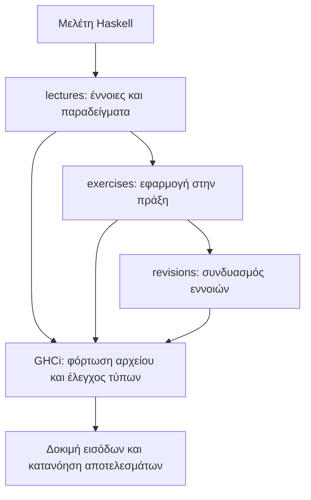
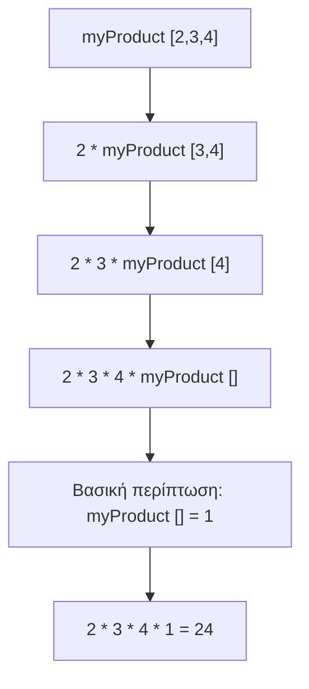
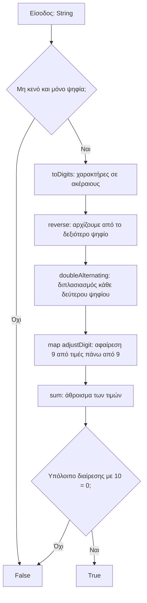
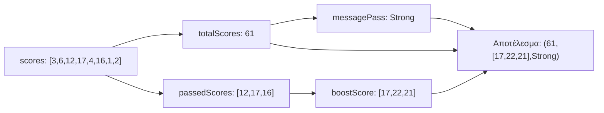

# Functional Programming με Haskell

Προσωπικό αποθετήριο μελέτης του συναρτησιακού προγραμματισμού: παραδείγματα διαλέξεων, εργαστηριακές ασκήσεις και επαναλήψεις σε Haskell. Το υλικό ξεκινά από απλές συναρτήσεις και φτάνει σε επεξεργασία λιστών, αναδρομή, αλγεβρικούς τύπους δεδομένων και μικρούς αλγορίθμους.

Κάθε αρχείο `.hs` είναι ένα ανεξάρτητο παράδειγμα που μπορείς να φορτώσεις στο GHCi. Οι εκφωνήσεις βρίσκονται μαζί με τις αντίστοιχες λύσεις στον φάκελο [`exercises`](exercises/).

## Χάρτης του αποθετηρίου

```text
functional-programming/
├── README.md
├── .gitignore
├── lectures/                       # Παραδείγματα και σημειώσεις διαλέξεων
│   ├── LA01/la01.hs
│   ├── LA02/la02.hs
│   ├── LA03/la03.hs
│   └── LA04/la04.hs
├── exercises/                      # Εκφωνήσεις και υλοποιήσεις ασκήσεων
│   ├── la01/
│   │   ├── Exercises.md
│   │   ├── S1_divide.hs
│   │   ├── S2_volumeCyclinder.hs
│   │   ├── S3_minOfTwo.hs
│   │   ├── S4_tellSignNum.hs
│   │   ├── S5_myProduct.hs
│   │   ├── M1_filterOdd.hs
│   │   └── M2_freeFallDistSeq.hs
│   └── la02/
│       ├── S1_S5/                  # Διανύσματα, tuples, slicing, palindromes
│       ├── M1/                     # Εξαγωγή κεφαλαίων χαρακτήρων
│       ├── M2/                     # Επεξεργασία στηλών πίνακα
│       ├── M3/                     # BMI και custom τύπος δεδομένων
│       └── L1/                     # Έλεγχος checksum με Luhn
└── revisions/                      # Συνδυαστικές ασκήσεις επανάληψης
    ├── revision_la01.hs
    ├── revision_la01_la03.hs
    ├── revision_la03.hs
    ├── revision_vol2_la01_03.hs
    └── revision_vol3_la01_03.hs
```

Το δέντρο παρουσιάζει τα αρχεία πηγαίου κώδικα και τεκμηρίωσης. Στο `exercises/la01/` περιλαμβάνονται επίσης τα υπάρχοντα εκτελέσιμα και τα αρχεία μεταγλώττισης `.hi` και `.o`.



## Πώς εκτελείς τον κώδικα

Χρειάζεσαι το **GHC**, το **GHCi** και το **runghc** διαθέσιμα στο terminal. Δεν υπάρχει ενιαίο project Cabal ή Stack· δουλεύεις με τα επιμέρους αρχεία.

Οι παρακάτω εντολές ξεκινούν από τον κεντρικό φάκελο του αποθετηρίου.

### 1. Φόρτωση μιας συνάρτησης στο GHCi

```bash
ghci exercises/la01/S5_myProduct.hs
```

Μέσα στο GHCi:

```text
ghci> :type myProduct
myProduct :: Num a => [a] -> a
ghci> myProduct [2,3,4]
24
ghci> myProduct []
1
ghci> :reload
ghci> :quit
```

Η `:type` εμφανίζει τον τύπο μιας συνάρτησης, ενώ η `:reload` φορτώνει ξανά το αρχείο μετά από αλλαγές. Μπορείς να αλλάξεις παράδειγμα με `:load`, π.χ.:

```text
ghci> :load exercises/la02/S1_S5/s2.hs
ghci> vecdot [1,2,3] [4,5,6]
32
```

Φόρτωνε ένα αρχείο κάθε φορά: αρκετά παραδείγματα έχουν κοινά ονόματα συναρτήσεων και δεν δηλώνουν ξεχωριστά modules.

### 2. Εκτέλεση ενός αρχείου που έχει `main`

```bash
runghc exercises/la01/M1_filterOdd.hs
```

Αναμενόμενο αποτέλεσμα:

```text
isOdd 2: False
filter_odd [1..10]
[1,3,5,7,9]
filter odd numbers in [1..10] using lambda function
[1,3,5,7,9]
```

Αντίστοιχα, το `runghc exercises/la01/M2_freeFallDistSeq.hs` εμφανίζει αποστάσεις ελεύθερης πτώσης για χρόνους από 1 έως 10 δευτερόλεπτα. Αρχεία που ορίζουν μόνο συναρτήσεις, χωρίς `main`, δοκιμάζονται στο GHCi.

### 3. Μεταγλώττιση σε εκτελέσιμο

```bash
mkdir -p build
ghc -outputdir build exercises/la01/M1_filterOdd.hs -o build/filter-odd
./build/filter-odd
```

Ο φάκελος `build/` αγνοείται από το Git. Τα ήδη αποθηκευμένα εκτελέσιμα μπορεί να εξαρτώνται από το περιβάλλον στο οποίο δημιουργήθηκαν· η παραπάνω εντολή δημιουργεί νέο εκτελέσιμο από τον πηγαίο κώδικα.

## Τι καλύπτουν οι διαλέξεις

| Αρχείο | Βασικές έννοιες |
| --- | --- |
| [LA01](lectures/LA01/la01.hs) | Συναρτήσεις, guards, pattern matching, αναδρομή σε λίστες, `Maybe`, `map`, `filter`, lambdas, σύνθεση συναρτήσεων, folds, tuples, `IO` και custom τύποι. |
| [LA02](lectures/LA02/la02.hs) | Type classes, `if`, guards, `case`, τοπικοί υπολογισμοί με `let ... in` και `where`. |
| [LA03](lectures/LA03/la03.hs) | Tuples, list comprehensions, enumerations και χρήση του `Enum`. |
| [LA04](lectures/LA04/la04.hs) | Σύνθετα patterns, as-patterns (`whole@(x:xs)`), εμφωλευμένες λίστες, pattern guards και επεξεργασία εγγραφών με tuples. |

Τα `LA01` και `LA02` περιέχουν import από το `Text.XHtml`. Αν η δική σου εγκατάσταση αναφέρει ότι το module λείπει, χρειάζεται το πακέτο `xhtml` για να φορτωθούν αυτά τα αρχεία όπως είναι.

## Εργαστήριο la01: από τους τύπους στις λίστες

Η πλήρης εκφώνηση βρίσκεται στο [`exercises/la01/Exercises.md`](exercises/la01/Exercises.md).

| Άσκηση | Συνάρτηση | Τι εξασκεί |
| --- | --- | --- |
| [S1](exercises/la01/S1_divide.hs) | `divide` | Ακέραια διαίρεση με `div` και συγκεκριμένους τύπους `Int`. |
| [S2](exercises/la01/S2_volumeCyclinder.hs) | `volumeCylinder` | Υπολογισμό όγκου κυλίνδρου με `pi * radius ^ 2 * height`. |
| [S3](exercises/la01/S3_minOfTwo.hs) | `minOfTwo` | Πολυμορφισμό και σύγκριση τιμών με περιορισμό `Ord`. |
| [S4](exercises/la01/S4_tellSignNum.hs) | `tellSignNum` | Guards για θετικούς, αρνητικούς αριθμούς και μηδέν. |
| [S5](exercises/la01/S5_myProduct.hs) | `myProduct` | Αναδρομή και βασική περίπτωση για το γινόμενο μιας λίστας. |
| [M1](exercises/la01/M1_filterOdd.hs) | `isOdd`, `filter_odd` | Predicates, `filter`, lambdas και εκτέλεση μέσω `main`. |
| [M2](exercises/la01/M2_freeFallDistSeq.hs) | `freeFallDist`, `freeFallDistSeq` | Τοπικούς υπολογισμούς και εφαρμογή συνάρτησης σε λίστα με `map`. |

### Πώς διαβάζεται ένας τύπος

```haskell
minOfTwo :: Ord a => a -> a -> a
```

Το `a` δηλώνει έναν γενικό τύπο. Ο περιορισμός `Ord a` απαιτεί να μπορούν να συγκριθούν οι τιμές του. Η συνάρτηση δέχεται δύο τιμές του ίδιου τύπου και επιστρέφει μία τιμή αυτού του τύπου.

Αντίστοιχα, στο `myProduct :: Num a => [a] -> a`, το `Num a` επιτρέπει αριθμητικές πράξεις, το `[a]` είναι λίστα αριθμών και το αποτέλεσμα είναι ένας αριθμός.

### Πώς λειτουργεί η αναδρομή

Η υλοποίηση του `myProduct` χωρίζει τη λίστα σε κεφαλή `x` και υπόλοιπο `xs`:

```haskell
myProduct :: Num a => [a] -> a
myProduct [] = 1
myProduct (x:xs) = x * myProduct xs
```



Η κενή λίστα επιστρέφει `1`, επειδή είναι το ουδέτερο στοιχείο του πολλαπλασιασμού. Κάθε αναδρομική κλήση επεξεργάζεται μικρότερη λίστα, μέχρι να φτάσει στη βασική περίπτωση.

### Η διαφορά ανάμεσα σε `filter` και `map`

Το `filter` επιλέγει ποια στοιχεία θα παραμείνουν, χρησιμοποιώντας μια συνάρτηση που επιστρέφει `Bool`. Το `map` εφαρμόζει έναν μετασχηματισμό σε κάθε στοιχείο.

```haskell
filter_odd [1..6]          -- [1,3,5]
freeFallDistSeq [0,1,2]    -- [0.0,4.9,19.6]
```

Στη δεύτερη περίπτωση, κάθε χρόνος `t` μετατρέπεται σε απόσταση με τον τύπο `0.5 * 9.8 * t²`. Η σταθερά `g = 9.8` ορίζεται τοπικά με `let ... in`.

## Εργαστήριο la02: σύνθετα δεδομένα και αλγόριθμοι

| Φάκελος | Περιεχόμενο | Κύριες τεχνικές |
| --- | --- | --- |
| [S1–S5](exercises/la02/S1_S5/README.md) | Μέτρο διανύσματος, εσωτερικό γινόμενο, δεύτερο στοιχείο tuple, slicing, έλεγχος palindromes. | Tuples, `sqrt`, `zipWith`, `sum`, `take`, `drop`, `map`, `reverse`. |
| [M1](exercises/la02/M1/README.md) | Εξαγωγή κεφαλαίων χαρακτήρων με δύο τρόπους. | `Data.Char.isUpper`, `filter`, list comprehension. |
| [M2](exercises/la02/M2/README.md) | Λήψη πρώτης στήλης και αφαίρεσή της από έναν πίνακα. | Λίστες λιστών, pattern matching, `map`, `head`, `tail`. |
| [M3](exercises/la02/M3/README.md) | Υπολογισμός BMI και επιστροφή τιμής μαζί με κατηγορία. | `BMILevel`, `deriving (Show, Eq)`, guards, tuple και `where`. |
| [L1](exercises/la02/L1/README.md) | Έλεγχος ψηφίων με τον αλγόριθμο Luhn. | Μετατροπή χαρακτήρων, αναδρομή ανά δύο στοιχεία και checksum. |

### Παράδειγμα: εσωτερικό γινόμενο

Στο [`s2.hs`](exercises/la02/S1_S5/s2.hs), η `vecdot` πολλαπλασιάζει τα αντίστοιχα στοιχεία με `zipWith (*)` και αθροίζει τα γινόμενα με `sum`:

```text
[1, 2, 3]   και   [4, 5, 6]
        ↓ zipWith (*)
         [4, 10, 18]
        ↓ sum
              32
```

Για το μαθηματικό εσωτερικό γινόμενο χρησιμοποιούμε διανύσματα ίδιου μήκους. Η συγκεκριμένη υλοποίηση ακολουθεί τη συμπεριφορά του `zipWith`: αν διαφέρουν τα μήκη, σταματά στη μικρότερη λίστα.

### Παράδειγμα: στήλες πίνακα

Στο [`m2.hs`](exercises/la02/M2/m2.hs), κάθε εσωτερική λίστα αναπαριστά μία γραμμή:

```haskell
firstColumn [[1,2,3],[4,5,6]]   -- [1,4]
restColumns [[1,2,3],[4,5,6]]   -- [[2,3],[5,6]]
```

Οι συναρτήσεις αποτελούν βήματα για την κατανόηση της μεταφοράς γραμμών σε στήλες· το αρχείο δεν υλοποιεί πλήρη μεταθετό πίνακα. Χειρίζεται την κενή εξωτερική λίστα και την περίπτωση όπου η πρώτη γραμμή είναι κενή. Αν όμως μια επόμενη γραμμή είναι κενή ενώ η πρώτη δεν είναι, τα `head` ή `tail` μπορούν να προκαλέσουν σφάλμα όταν αξιολογηθεί το αντίστοιχο αποτέλεσμα. Για τα συνήθη παραδείγματα χρησιμοποιούμε ορθογώνιους πίνακες με μη κενές γραμμές.

### Παράδειγμα: custom τύπος και αποτέλεσμα με δομή

Στο [`m3.hs`](exercises/la02/M3/m3.hs), η κατηγορία αναπαρίσταται με συγκεκριμένους constructors:

```haskell
data BMILevel = Underweight | Normal | Overweight | Obese
    deriving (Show, Eq)

evaluateBMI :: Float -> Float -> (Float, BMILevel)
```

Η `evaluateBMI 70.0 1.75` επιστρέφει περίπου `(22.857143,Normal)`. Το tuple συνδυάζει την αριθμητική τιμή με την κατηγορία, ενώ ο τύπος `BMILevel` καθορίζει τις επιτρεπόμενες κατηγορίες. Η άσκηση υποθέτει έγκυρες εισόδους με `height > 0`.

### Αναλυτική ροή του Luhn

Η [`checkCCNumber`](exercises/la02/L1/l1.hs) ελέγχει πρώτα ότι το string δεν είναι κενό και περιέχει μόνο ψηφία. Στη συνέχεια ακολουθεί τα παρακάτω βήματα:



Παράδειγμα με το string `"1230"`:

| Βήμα | Αποτέλεσμα |
| --- | --- |
| `toDigits` | `[1,2,3,0]` |
| `reverse` | `[0,3,2,1]` |
| `doubleAlternating` | `[0,6,2,2]` |
| `map adjustDigit` | `[0,6,2,2]` |
| `sum` | `10` |
| `10 mod 10 == 0` | `True` |

Η αντιστροφή επιτρέπει στη `doubleAlternating` να κρατά το πρώτο ψηφίο και να διπλασιάζει το δεύτερο, επαναλαμβάνοντας το ίδιο pattern ανά ζεύγος. Αν προκύψει, για παράδειγμα, `16`, η `adjustDigit` το μετατρέπει σε `7`, ισοδύναμα με το άθροισμα `1 + 6`.

Το αποτέλεσμα αφορά μόνο το checksum Luhn. Η υλοποίηση δεν ελέγχει συγκεκριμένο μήκος, εκδότη ή αν ένας αριθμός αντιστοιχεί σε υπαρκτή κάρτα, γι' αυτό και το σύντομο `"1230"` περνά τον έλεγχο.

## Επαναλήψεις: συνδυάζοντας όσα έμαθες

| Αρχείο | Αντικείμενο επανάληψης |
| --- | --- |
| [revision_la01.hs](revisions/revision_la01.hs) | Αναδρομικό άθροισμα, ασφαλής πρόσβαση στο πρώτο στοιχείο με `Maybe`, φιλτράρισμα βαθμών, `Level` και `main`. |
| [revision_la01_la03.hs](revisions/revision_la01_la03.hs) | Βαθμοί, guards, `let`, `where`, tuples, `zip`, list comprehensions και κεφαλαιοποίηση string. |
| [revision_la03.hs](revisions/revision_la03.hs) | Tuples, list comprehension, enumeration και `map toUpper`. |
| [revision_vol2_la01_03.hs](revisions/revision_vol2_la01_03.hs) | Συνδυασμός αθροίσματος, επιλογής βαθμών, προσαύξησης και μηνύματος σε ένα tuple. |
| [revision_vol3_la01_03.hs](revisions/revision_vol3_la01_03.hs) | Τιμές, εκπτώσεις, φόροι, παραγγελίες και συνδυασμοί `filter`, `map`, `zipWith`, `let` και `where`. |

Η `analyticsScores` στο δεύτερο volume δείχνει πώς ένα πρόβλημα χωρίζεται σε μικρές συναρτήσεις και πώς συνδυάζονται τα αποτελέσματά τους:



Δοκίμασέ το στο GHCi:

```text
ghci> :load revisions/revision_vol2_la01_03.hs
ghci> analyticsScores scores
(61,[17,22,21],"Strong")
```

Το μήνυμα βασίζεται στο άθροισμα **όλων** των αρχικών βαθμών. Η λίστα του αποτελέσματος περιέχει μόνο όσους είναι τουλάχιστον `10`, αφού αυξηθούν κατά `5`.

## Προτεινόμενος τρόπος μελέτης

1. Διάβασε την υπογραφή της συνάρτησης και εντόπισε εισόδους, αποτέλεσμα και περιορισμούς τύπων.
2. Άνοιξε την εκφώνηση και υπολόγισε ένα μικρό παράδειγμα στο χαρτί.
3. Φόρτωσε τη λύση στο GHCi και σύγκρινε το αποτέλεσμα με την πρόβλεψή σου.
4. Δοκίμασε οριακές περιπτώσεις, όπως κενές λίστες, μηδέν ή ένα μόνο στοιχείο. Για παράδειγμα, η `divide` δεν χειρίζεται μηδενικό διαιρέτη και η `divide 8 0` προκαλεί εξαίρεση.
5. Προσπάθησε να γράψεις μια εναλλακτική λύση: αναδρομή αντί για `map`, `filter` αντί για list comprehension ή `where` αντί για `let`.
6. Συνδύασε τις έννοιες στα αρχεία του `revisions/` και εξήγησε με δικά σου λόγια κάθε ενδιάμεσο αποτέλεσμα.

## Τι διατηρείται στο Git

Ο φάκελος `exercises/` διατηρεί **όλα τα αρχεία του**, μαζί με εκφωνήσεις, πηγαίο κώδικα, υπάρχοντα εκτελέσιμα και αρχεία `.hi` / `.o`. Το [`.gitignore`](.gitignore) περιέχει ρητή εξαίρεση για ολόκληρο τον φάκελο.

Εκτός του `exercises/`, τα αρχεία `.hi`, `.o`, `.dyn_hi`, `.dyn_o` και ο κεντρικός φάκελος `build/` αγνοούνται. Έτσι μπορείς να χρησιμοποιείς το `build/` για νέες τοπικές μεταγλωττίσεις, διατηρώντας όλα τα περιεχόμενα των ασκήσεων στο αποθετήριο.
